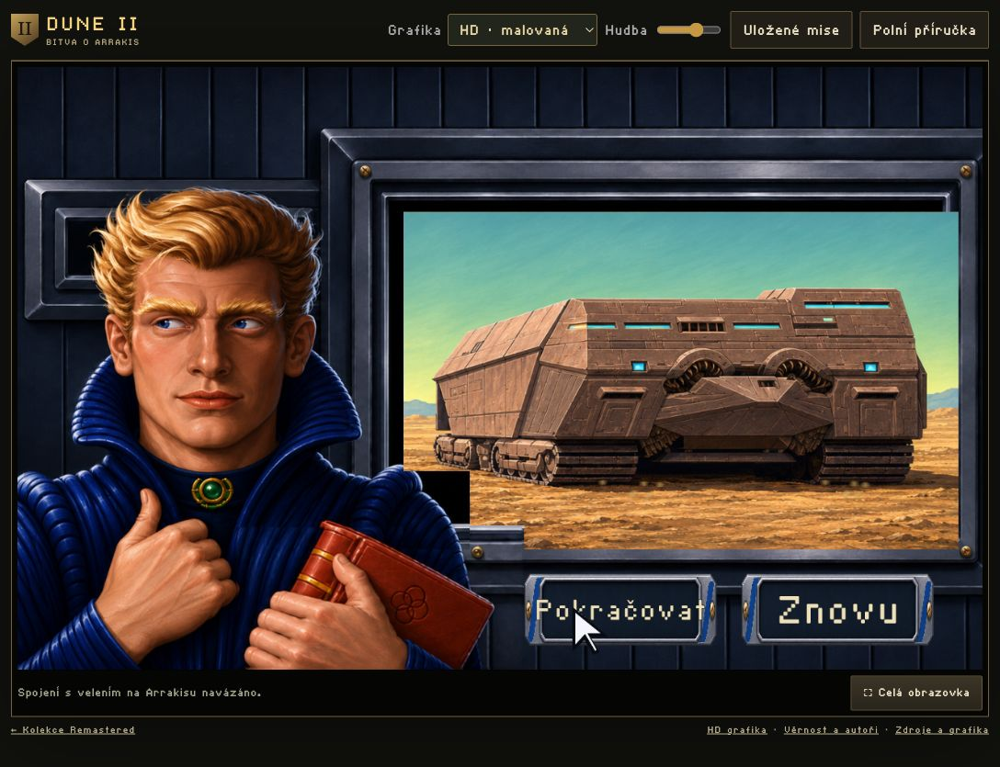
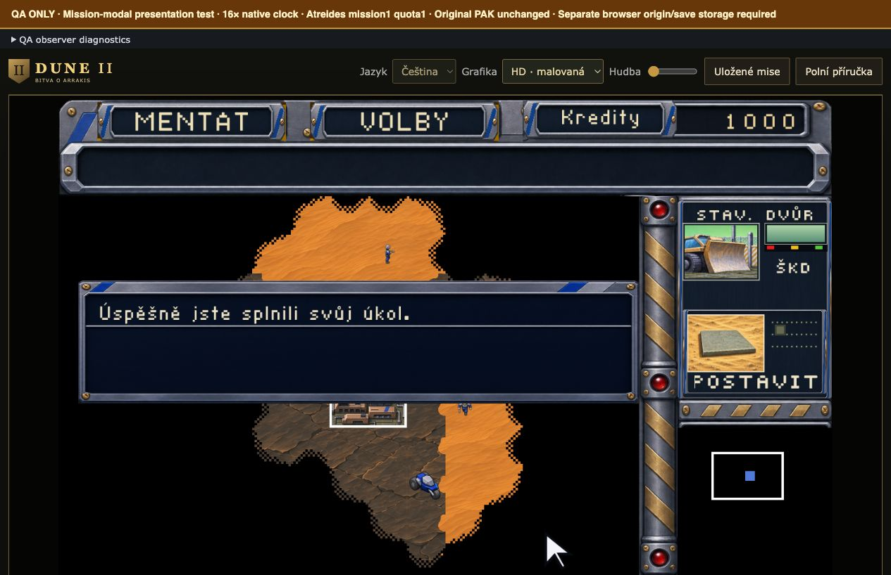

# Period typography and Czech — 0.8 browser review

The game now uses original-derived NEW8P/NEW6P vector contours, a matching local
WOFF in the browser shell, Czech accents and explicit punctuation. The actual
Dune II title silhouette is traced separately. Semantic button captions share a
bounded nine-pixel cap height, so short words do not grow much larger than their
neighbours. No system font is used for painted game lettering.

The complete Czech resources load before native File_Init as hash-verified
virtual files. English/Czech can be chosen before entering the game. English
retains CP437; Czech uses Windows-1250 and the native observer decodes those bytes
into Unicode. No original game archive is edited. Native string IDs, formatting,
control bytes, resource references, help gates and save formats are preserved.
Original voice recordings retain their language.

Live browser traversal verified the Czech launch page, house selection, Caladan
narrative, correct Atreides confirmation, Cyril's mission briefing, actual WIN1
mission outcome and statistics. Every observed text frame had zero fit errors.
The existing Word-like serif/sans lettering has been replaced with period shapes.
A separate native observer regression covers the newly found victory/defeat
modal transition: the committed painted map remains visible until the actual
Mentat screen replaces it. This does not change mission rules or timers.

The inert production-UI fixtures separately verify 35 English advisor cases,
12 English outcomes, 162 English credit cases; 18 Czech compositions, three
English confirmations, both language variants of house selection, four cursor
positions, a Czech Options window and 162 Czech credit phases. House-name
recognition uses only exact source pixels that differ among the three candidates.
Common panel backgrounds cannot pick the wrong house. Both complete house-choice
renders are invariant under deliberately poisoned native underlays, and their
captions fit the actual 71×13 gold plates.

The native short-label audit uses the actual font flags and spacing: full
names/descriptions remain complete while bounded HUD headings/actions use
compact Czech forms, including ŠKD, Těžit, Hlídka and Lovit. This prevents native
line wrapping outside the original small fields in either graphics mode.

Live Czech HUD, F1 help descriptions, F2 Options and Original/HD switching also
passed with zero renderer/text-fit errors. The separate port6003 experiment
used a virtual scenario copy (quota 1 and WinFlags 4) and a 16x clock. It verified
the same rebuilt engine retaining five committed commands and the HD map/HUD
inside the paused victory modal, then hiding the map before WIN1. Original
PAKs and production scenario files were untouched. This is a bounded
presentation experiment, not an original timing comparison.

[Modal results](modal-browser-results.json), [full Czech/English composition results](locale-final-results.json)
and [release checks](release-checks.json) preserve the exact observations. All 895
collection tests passed, including 168 Dune tests. All 58 selected generated art,
font and localization artifacts rebuild byte-identically. A separate regression
runs the landing builder and verifies that the authored period stylesheet, its
load order and the HTML remain unchanged across regeneration in an isolated
temporary tree. Live review also verifies the same period face throughout the
Czech field-manual dialog, its body, accents and buttons. Source-package reconstruction and the committed
revision are recorded separately by the release checklist. This controlled review does not constitute exhaustive acceptance of
every campaign or every Czech cinematic subtitle at native cue timing.

